  

# 🚀 Aspiring AI/ML Engineer | MLOps & Full-Stack Development

🎓 **Full-Stack ML Engineer | Bridging the gap between software engineering and production-grade Machine Learning.**  
🧠 **Passionate about ML Infrastructure**, DevOps automation, and Scalable Web Development.  
💡 **Focusing on Model Productionalization** and bridging the gap between code and cloud.

---

 

  

  

<h3 align="center">🤖 AI / ML & Agentic Systems</h3>

  🐍 Python &nbsp;•&nbsp; 🧠 TensorFlow &nbsp;•&nbsp; 🔥 PyTorch &nbsp;•&nbsp; 📊 Scikit-learn 
  🐼 Pandas &nbsp;•&nbsp; 🔢 NumPy &nbsp;•&nbsp; 📓 Jupyter &nbsp;•&nbsp; 👁️ OpenCV 
  🦜 LangChain &nbsp;•&nbsp; 🔗 LangGraph &nbsp;•&nbsp; 📚 RAG 
  🤗 Hugging Face &nbsp;•&nbsp; ⚡ Groq &nbsp;•&nbsp; ♊ Gemini 
  🎈 Streamlit &nbsp;•&nbsp; 🦙 Ollama

<h3 align="center">🌐 Full-Stack Development</h3>

  🟨 JavaScript &nbsp;•&nbsp; 🔷 TypeScript &nbsp;•&nbsp; ⚛️ React &nbsp;•&nbsp; ▲ Next.js 
  🟢 Node.js &nbsp;•&nbsp; ⚡ FastAPI &nbsp;•&nbsp; 🌶️ Flask &nbsp;•&nbsp; 🎸 Django 
  🧱 HTML5 &nbsp;•&nbsp; 🎨 CSS3 &nbsp;•&nbsp; 🌊 Tailwind CSS

<h3 align="center">🗄️ Databases, DevOps & Cloud</h3>

  🐘 PostgreSQL &nbsp;•&nbsp; 🍃 MongoDB &nbsp;•&nbsp; 🔴 Redis 
  ⚡ Supabase &nbsp;•&nbsp; 🧬 pgvector &nbsp;•&nbsp; 🟣 ChromaDB 
  🐳 Docker &nbsp;•&nbsp; ☁️ AWS &nbsp;•&nbsp; 🌐 Google Cloud 
  🔥 Firebase &nbsp;•&nbsp; 🏗️ Terraform

<h3 align="center">⚙️ ML Engineering & Developer Tools</h3>

  🔬 MLflow &nbsp;•&nbsp; 📦 DVC &nbsp;•&nbsp; ☸️ Kubernetes 
  🔄 GitHub Actions &nbsp;•&nbsp; 📈 Prometheus &nbsp;•&nbsp; 📊 Grafana 
  🔀 Git &nbsp;•&nbsp; 🐙 GitHub &nbsp;•&nbsp; 🐧 Linux 
  ☕ Java &nbsp;•&nbsp; 🐹 Go &nbsp;•&nbsp; 🗃️ SQL &nbsp;•&nbsp; 🐚 Bash 
  🛠️ Pydantic &nbsp;•&nbsp; 🔌 MCP &nbsp;•&nbsp; 🧪 Pytest

###  3D Contribution Graph

  

---

### 📫 Let's Connect

